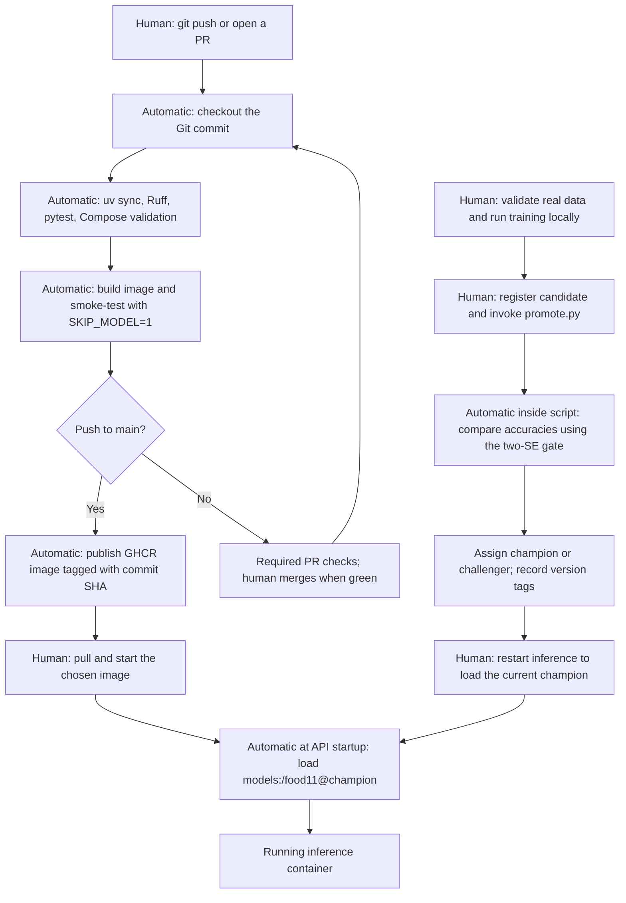

Question 1: Why is it a bad idea for a unit test to load the real model from your MLflow server? List at least two ways the test could fail even though your code is correct.

Loading the real model makes the test depend on services and artifacts outside the code being tested.
The test could fail because MLflow is stopped or unreachable, or because the champion alias or model artifacts are missing.
It could also fail because downloading the model times out or the machine does not have compatible model dependencies.
Using a fake model makes the unit test fast and repeatable without a GPU, DVC data, or a running MLflow server.

Question 2: The fake model always answers "Bread" with 0.90 confidence. What exactly does test_predict_returns_valid_json prove, and what does it not prove?

The test proves that the API accepts a multipart image upload, decodes and preprocesses it, calls the supplied model, and returns a successful JSON response with the expected category and a confidence between 0 and 1.
Our API expects logits, so the fake model returns the logarithms of the fixed probabilities. The API's softmax then produces 0.90 confidence for Bread.
The test does not prove that the real model classifies food accurately, that MLflow is reachable, or that the champion alias and its artifacts can be loaded.

Question 3: Which check caught it? Why is a train/test duplicate more dangerous than a corrupted image, even though the corrupted image makes the training script crash and the duplicate does not?

The cross-split content-hash check caught the copied image and returned exit code 1.
The existing mini dataset already contains 43 duplicate pairs across splits. Adding training/Bread/0_0.jpg as evaluation/Bread/lab5_duplicate_demo.jpg increased the count to 44. The deliberate copy was then removed; the original dataset was preserved.
The class folders, RGB/128x128 image format, minimum 50 images per class, and class balance checks passed.
A corrupted image causes a visible failure. A train/test duplicate can silently inflate test accuracy because the model has already seen the image during training, making the reported performance misleading.

Question 4: Your CI runner cannot see your data (it is in DVC, and maybe in a local remote). Where in your workflow should validate_data.py run so that it still protects you? Give two places.

Run it locally after preparing or pulling the processed data and before training.
Run it again on the training machine or a self-hosted runner with access to the real dataset, before training or accepting a new dataset version.
Cloud CI can test the validator using generated temporary datasets, but those tests do not validate the real DVC dataset.
On this project the real-data command is:

```powershell
uv run python src/food11/validate_data.py BigData/food11_processed_mini
```

Question 5: The smoke job has needs: test. What happens to it if a unit test fails? What would happen without needs?

If a unit test fails, the test job fails and GitHub skips smoke because its dependency did not succeed.
Without needs, GitHub can run smoke independently of test, so the image might build and start even while unit tests fail.

The first GitHub run demonstrated this: test failed during collection because the pytest command did not include the repository root on its import path, and smoke was skipped. Adding pythonpath = ["."] to the project's pytest settings fixes the src imports for the handout's uv run pytest -q command.

Question 6: How long did the whole run take? Run it a second time and compare. Which step got faster, and why?

After fixing test collection, the first successful run took 1 minute 23 seconds from creation to completion:
https://github.com/MarioAouad/mlops-lab-1/actions/runs/40838481200
The second run, triggered by git commit --allow-empty -m "ci", took 1 minute 28 seconds:
https://github.com/MarioAouad/mlops-lab-1/actions/runs/40838666653
The second run restored the uv cache. Package installation inside uv sync decreased from 689 ms to 439 ms, although the complete sync step was about 3 seconds in both runs.
The Docker build decreased from 35 seconds to 28 seconds, but this smoke job does not configure a shared Docker layer cache, so that difference alone is not evidence of cross-run Docker caching.
The overall second run was five seconds slower because other work and runner timing varied; caching does not guarantee that the complete run will always be faster.

Question 7: Why tag with the commit SHA rather than latest? Describe a concrete situation where latest leads two machines to run different code.

The commit SHA identifies which code revision an image was built from and allows us to select that release explicitly. An image digest identifies the exact image bytes.
The latest tag can be reassigned. Machine A can pull latest on Monday and keep that image cached, while machine B pulls latest after Tuesday's update. Both say latest but run different code.
Our registry image name is ghcr.io/marioaouad/mlops-lab-1, using lowercase as required by the handout.

Question 8: Why does the push job declare permissions explicitly? What could a compromised step do with a token that had write access to everything in the repo?

The push job needs contents: read to check out code and packages: write to publish the image. Declaring these permissions gives the job only the rights it needs.
A compromised step with broad write access could alter repository code, publish malicious releases or packages, or change other resources permitted by its token.

The publishing pipeline completed successfully:
https://github.com/MarioAouad/mlops-lab-1/actions/runs/40838844573
The commit-tagged image is ghcr.io/marioaouad/mlops-lab-1:46942e0dbb637fe7e6221dff5c79f8b5e684d59a.
The local docker pull succeeded with digest sha256:05828723bd759c47424effabe56b249a6fb8013205856cbbd492f3c12909a9f6.
Running this published image locally with SKIP_MODEL=1 gave health 200 and predict 503. Running it on the Compose network against the real MLflow champion gave health 200 and a successful Bread prediction with confidence 0.995969. Both temporary verification containers were removed afterward.

Question 9: What does the pull request page show? Could you still merge? What does that change for a team compared to "everybody runs the tests on their laptop before pushing"?

We enabled a protection rule for main that requires a pull request and successful test and smoke checks, including for administrators. No extra approving reviewer is required for this individual lab.
On branch lab5-branch-protection, we deliberately shifted the filename class mapping by one category and opened:
https://github.com/MarioAouad/mlops-lab-1/pull/1
The test check failed, smoke and push were skipped, and GitHub reported the PR's mergeable_state as blocked. The branch had no merge conflict, but the required checks prevented merging.
This gives the team a shared, enforced check of the proposed code rather than relying on each person to remember to run tests locally.
We then restored the correct mapping and pushed the fix before merging.
The fixed PR passed its required checks and was squash-merged into main as b6fa80a9b41405eb99b3f2c856069d5184a3dacd.

Question 10: For each candidate, what did the gate decide, and with which numbers? With your test-set size, how many accuracy points does 2 * se represent?

These experiments use the unchanged Food-11 mini dataset and its evaluation split of 1,096 images. Its existing cross-split duplicates, reported in Question 3, remain a limitation of these accuracy measurements.
The active Compose registry's champion is food11 version 2. Its import run had no test_accuracy because the Lab 4 bootstrap copied artifacts but not metrics.
We verified that the imported and original model.pth files have identical SHA-256 hashes, then copied the original run's recorded test_accuracy into the import run and added provenance tags. The original local database was read in read-only mode and the champion alias was unchanged.
Original run: 8eadc6a2e9eb4237b7a81cfafccecdaa. Compose import run: 5677a329b88a4a7882324367e9fc45e3.
Verified model SHA-256: 6425eaaa6a3e8152126f29ee4f28397b1a475327bfde971eb5a2658aa2daaafa.

Champion accuracy p = 0.823905109489051 (82.3905%).
With n = 1096, se = sqrt(p * (1 - p) / n) = 0.01150553183544775.
Therefore 2 * se = 0.0230110636708955, or 2.3011 percentage points.
A candidate must reach at least 0.8469161731599465 (84.6916%) to be promoted.

| Candidate version | Run ID | Learning rate | Epochs | Test accuracy | Gate decision |
| --- | --- | --- | --- | --- | --- |
| 3 | 49cc7a7b44e74039b22a6b3220c1c1f0 | 0.0000001 | 1 | 9.8540% | challenger; champion stays at version 2 |
| 4 | a2d693dc6e8948b091d46845057ebd74 | 0.0001 | 5 | 81.5693% | challenger; champion stays at version 2 |

The script records the decision, both accuracies, the previous champion version, test-set size, standard error and threshold as promotion.* tags on each candidate version.
After both decisions, champion points to version 2 and challenger points to version 4. Version 3 retains its recorded challenger decision in its tags.
Both candidates used batch size 32 and seed 42. We invoked src/food11/promote.py --version 3 and then --version 4 against the local Compose MLflow server at http://127.0.0.1:5001.

Question 11: promote.py needs to reach your MLflow server, so it cannot run in GitHub's cloud runners while MLflow lives on your laptop. Name two ways to make it run automatically after training.

One option is a local training script that trains, registers the resulting model, and invokes promote.py after successful training. All steps can reach the same local MLflow server.
Another is a self-hosted GitHub Actions runner on the training machine or its network, which runs promotion after training and registration complete.
A hosted MLflow server such as DagsHub would also allow a cloud workflow to reach the registry with the appropriate credentials.

Question 12: Draw the pipeline you now have, from git push to a running container. Mark which steps are automatic, which still need a human, and where the code version and the model version are decided.



The code revision is chosen by the Git commit used for the build and its SHA image tag. The model version is chosen separately by the champion alias when inference starts.
The image pipeline does not automatically deploy the container, train the real model, invoke promotion, or restart inference after an alias change.
